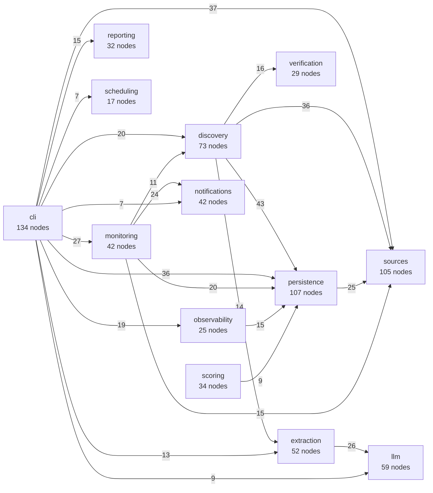

# OpenHypergamy

[](https://github.com/r00tnomade/open-hypergamy/actions/workflows/ci.yml)
[](LICENSE)


**Career hypergamy. Open source.**

*LARP never stops. Professionally.*

Stop finding out about the good stuff after the deadline.

OpenHypergamy watches the places where good opportunities actually get announced (research labs, fellowships, summer schools, hackathons, calls for papers), checks the facts against the official page, scores what's worth your time, and pings you on Telegram before the window closes. It runs on your laptop. Your profile never leaves it.

> The command is `ohg`, the package is `open_hypergamy`. Python 3.12+, macOS first.

## The rules of the game

1. **Official page or it didn't happen.** A date is *confirmed* only when an official source says it in text we can quote back, and the checks pass. Feeds, aggregators, manual entries and the LLM can all tell you where to look. None of them can confirm anything.
2. **A broken fetch is not news.** A 404 doesn't cancel a programme. A timeout doesn't erase a deadline. The last known fact stays, and it gets marked stale until someone re-checks it.
3. **Estimated stays estimated.** If a date isn't confirmed, you'll see that label everywhere: alerts, reports, calendar. No joke is worth a wrong deadline.
4. **Honest coverage.** The goal is about 200 curated sources. `ohg report sources` tells you how many you actually have, how many are healthy, and what's missing. It never rounds up.
5. **No guarantees.** This finds the doors. It doesn't get you through them.

## 60 seconds to a working install

```bash
uv sync
uv run ohg init       # creates ~/Library/Application Support/OpenHypergamy
uv run ohg doctor     # tells you what's missing
uv run ohg status     # real counts: sources, jobs, review queue, backups
```

A fresh install has **zero sources**, on purpose (see [Find the sauce](#find-the-sauce-adding-sources)). Everything below is optional until you add some.

Developing? Point `OHG_HOME` at a temp dir so you never touch your real data: `OHG_HOME=$(mktemp -d) uv run ohg init`.

## How it works

Data flows one way. Each stage has a narrow job, and nothing reaches backwards.

```text
sources ──▶ discovery ──▶ extraction ──▶ verification ──▶ promotion
 fetch +     dedupe,       dates first,   quote-check,      one DB
 adapters    candidates    LLM second     official only     transaction
                                                               │
        reports, .ics, Telegram ◀── alerts ◀── scoring ◀───────┘
                                    sentinel   fit + urgency
```

| Layer | Does | Never does |
| --- | --- | --- |
| **Sources** | Fetch pages and feeds, throttle per host, return observations or typed failures | Write opportunities, message you, score anything |
| **Extraction** | Pull dates and wording deterministically; optionally ask the LLM for the messy prose | Confirm a fact |
| **Verification** | The *only* place a fact can become `confirmed_official` | Trust a quote it can't find literally in the page |
| **Scoring** | Fit (30/25/20/15/10 weights) and urgency, kept separate, with reason codes | Touch the network |
| **Sentinel + alerts** | Re-check imminent deadlines; remind at 30, 14, 7 and 2 days; write the outbox row *before* sending | Send the same alert twice |

## The architecture, as measured

<!-- architecture:start (generated by scripts/update_architecture.py) -->
Generated from the code, not drawn by hand: [graphify](https://github.com/Graphify-Labs/graphify) parsed `src/` with tree-sitter (no LLM involved) into **1018 nodes and 3621 edges**. Nodes are grouped by package. An arrow `a -->|n| b` means `a` calls, imports or uses `b` in `n` places. Only edges read directly from the source are counted, arrows under 7 uses are hidden, and the shared plumbing (`clock`, `errors`, `config`, `domain`) is left out because nearly everything uses it.



- **One-way flow.** Nothing in `sources` calls back into `discovery`.
- **The CLI is a thin shell.** Nothing points into `cli`; it only calls service packages.
- **Hubs.** The most connected nodes are `Clock` (73), `OpportunityRepository` (70), `SystemClock` (56).

Refresh with `graphify update src && python3 scripts/update_architecture.py`; `--check` fails if this block is stale. Open `src/graphify-out/graph.html` for the interactive graph (the output folder is gitignored).
<!-- architecture:end -->

### What the labels mean

| Label | Meaning | Where you'll see it |
| --- | --- | --- |
| `confirmed_official` | An official source said it, we quoted it, the checks passed | Alerts, reports, calendar |
| `announced_not_open` | Official source says it's coming, no dates yet | Reports |
| `estimated_recurring` | Guessed from last year's cycle | Labelled everywhere; left out of `.ics` by default |
| `unverified` | A lead, an aggregator, or LLM output | Review queue only |

`ohg review accept` records that *you* looked at something. It never upgrades a fact to `confirmed_official`.

## Setup

Write your profile (degree level, year, interests). It stays local and never goes to the LLM or Telegram:

```bash
cp config/profile.example.yaml "$HOME/Library/Application Support/OpenHypergamy/profile.yaml"
```

Telegram, so the pipeline can yell at you. Tokens go in the macOS Keychain, because scheduled jobs don't inherit your shell (and the app doesn't read `.env`):

```bash
uv run ohg secrets set TELEGRAM_BOT_TOKEN
uv run ohg secrets set TELEGRAM_CHAT_ID
uv run ohg notify test
```

Optional LLM route, for the messy prose (eligibility wording, funding details): run [FreeLLMAPI](https://github.com/tashfeenahmed/freellmapi) on `127.0.0.1:3001` with a free-tier-only chain called `ohg-free`, then:

```bash
uv run ohg secrets set OHG_FREELLMAPI_API_KEY
uv run ohg llm ack     # you confirm: redacted public excerpts may reach upstream providers
uv run ohg llm status
```

Skip it and everything still works. You just lose the LLM-proposed extras, which were only ever suggestions anyway. Only redacted excerpts of public pages ever go to the gateway: never your profile, paths, secrets or Telegram IDs.

## Find the sauce (adding sources)

The `config/sources/*.yaml` batch files are **empty on purpose**. Nobody verified real URLs or site terms on your behalf, and filling the quota with junk defeats the point. Quality over count.

Start from the research candidates in [`docs/research/sources-2026-10/`](docs/research/sources-2026-10/): 50 sources with evidence, scores and policy notes, plus draft YAML under `draft_sources/`. They are *candidates*, not approvals. A successful probe means "the page loaded and parsed", nothing more.

For each source, in batches of about ten:

1. **Read the terms.** `robots.txt` is shown for information only (see [Security and responsible use](#security-and-responsible-use)); the terms and your own judgement decide.
2. **Write it down** in the entry: `terms_review_note` and `robots_policy_checked_at`, plus a `portfolio`.
3. **Probe** it: `uv run ohg sources probe config/sources/de_research.yaml` (live check, imports nothing).
4. **Import** it: `uv run ohg sources import config/sources/de_research.yaml`. Entries without a recorded review land *disabled*. That's a feature.
5. **Audit**: `uv run ohg sources audit` shows what's still weak.
6. **Enable** only after a real run extracted the right dates and eligibility: `uv run ohg sources enable <key>`.

Adapters today: `rss_atom`, `html`, `sitemap`. Sources that need iCal, JSON/YAML, authenticated APIs or a browser are recorded as `skipped`, not failed.

## Run the pipeline

```bash
uv run ohg run all          # catch-up: sentinel, discovery, LLM queue, scoring, alerts
uv run ohg run sentinel     # daily: re-verify imminent deadlines, fire reminders
uv run ohg run digest       # weekly Telegram digest (--dry-run to just print it)
```

If your laptop slept through a week, you get the most urgent reminder and a note that monitoring had a gap, not a pile of stale pings.

### Cheat sheet

| I want to… | Command |
| --- | --- |
| See what's worth my time | `ohg opportunities list` |
| See the quote behind a fact | `ohg opportunities show <id> --evidence` |
| See what's due | `ohg deadlines --within 60d` |
| See what to do next | `ohg actions list` (`done` / `dismiss` to clear) |
| Tell it what I decided | `ohg opportunities set-action <id> applied` (`auto` hands control back) |
| Work the review queue | `ohg review list` → `show` → `accept` / `reject` / `resolve` |
| Handle leads | `ohg candidates list`, `add <url>`, `promote`, `reject` |
| Read the week | `ohg report weekly`, `ohg report changes --since 7d` |
| Check real coverage | `ohg report sources`, `ohg sources coverage` |
| Put dates in my calendar | `ohg export-ics --output ~/ohg.ics` |
| Debug a source | `ohg sources test <key>`, `ohg sources failures` |

### Put it on a schedule

```bash
scripts/install_launchd.sh      # sentinel + backup daily, discovery + digest weekly
scripts/uninstall_launchd.sh
```

`ohg status` lists anything overdue, so a sleeping Mac doesn't fail silently.

### Backups

`ohg db backup` runs daily (keeps 7 daily + 4 weekly). Check one with `ohg db restore --check FILE`, or restore into a throwaway file with `ohg db restore FILE --to /tmp/test.sqlite3`. Your live database is never overwritten.

## Security and responsible use

OpenHypergamy is a tool for discovering, monitoring and researching publicly announced opportunities. It reads pages you point it at, at modest rates, from your own machine.

**Your responsibility.** You decide which sources to configure and how to use what they return. Make sure your use complies with applicable law, any contracts you have agreed to, and the rights of third parties. Public accessibility alone does not give you permission to reproduce, redistribute or commercially exploit content. Copyright, database rights, privacy law and each site's terms of service apply independently of one another and of anything this software does or does not check.

**robots.txt.** OpenHypergamy does not enforce robots.txt. It may retrieve the file and show what it says, but source policy is yours to set in the source configuration, and a missing objection in robots.txt is not permission. Read the terms of every source before enabling it, and record that review in the entry.

**What the software will not do.** It is not designed to bypass authentication, paywalls, CAPTCHAs, IP blocks or other technical access controls, and it must not be used or modified for that purpose. A `403` or similar response is treated as a stop-and-review signal, `429` and `Retry-After` are honoured, and requests to loopback, private and link-local addresses are refused.

**Be a good neighbour.** Keep request rates low, leave the per-host throttle in place, prefer feeds and published APIs, and do not put load on services that are not yours. If a site owner asks you to stop, stop.

**No warranty.** The software is provided "AS IS", without warranty of any kind, to the extent permitted by applicable law. The maintainers do not authorize unlawful use and accept no responsibility for how it is used.

*This notice is not legal advice. It does not establish that any particular crawling or reuse activity is lawful. If you are unsure, ask a qualified lawyer or the site's operator.*

## Docs map

| Where | What |
| --- | --- |
| `docs/design/open_hypergamy_lld_v1_2.md` | The implementation contract: schema, interfaces, CLI, test matrix |
| `docs/design/open_hypergamy_hld_v1_2.md` | Rationale, goals, trust tiers, risks |
| `docs/adr/` | Decisions that clarify or override the LLD (start with ADR-008 for robots.txt) |
| `docs/research/` | Source research: evidence, scores, policy notes, draft configs |
| `CLAUDE.md` | Contributor and agent notes, invariants that must not break |
| `CONTRIBUTING.md` | Setup, the four checks, how to propose sources |
| `SECURITY.md` | How to report a vulnerability privately |
| `CHANGELOG.md` | What changed, per version |

## Share the sauce

Gatekeeping opportunities is a poverty mindset. Sources, fixes and better extraction rules are all welcome. The one rule: don't trade factual clarity for a punchline, and don't let anything but an official source confirm a deadline.

## Development

```bash
uv run pytest && uv run ruff check . && uv run ruff format --check . && uv run mypy
```

Tests fake the network, DNS, the LLM gateway, Telegram, the Keychain and launchd. None of them touch the real ones. Never remove `extend-exclude = ["*.md"]` from the Ruff config, or the formatter will rewrite the Python snippets inside the design docs.

## Status

Built and tested end to end against fakes. Not yet run against the real FreeLLMAPI gateway, the real Telegram API, a live Keychain or an actual launchd. No sources are seeded, and none of the research candidates is approved or enabled. Run `ohg doctor`, then `ohg notify test`, before you trust it with a deadline. Touch grass occasionally.

## License

MIT, see [LICENSE](LICENSE). The responsible-use notice above still applies.
