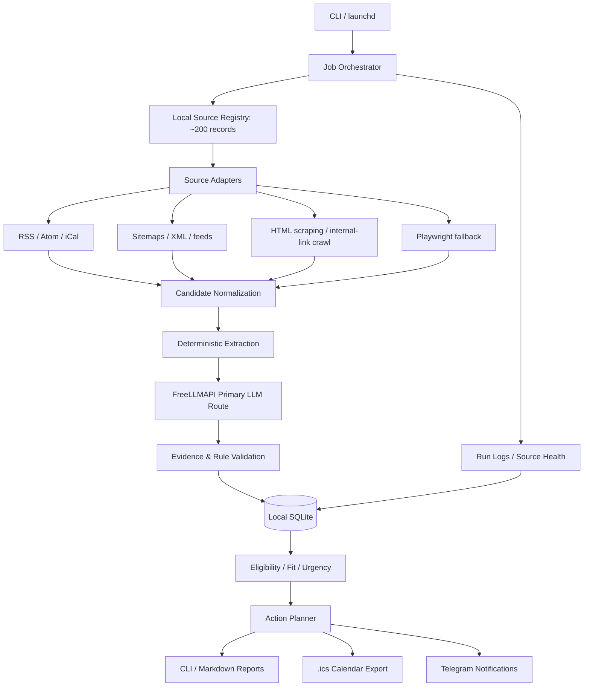

# Opportunity Radar — High-Level Design (HLD)

**Document status:** Proposed architecture, updated to confirmed user requirements  
**Version:** 1.2  
**Date:** 29 October 2026  
**Runtime model:** Local CLI and local data store; primary LLM route through local FreeLLMAPI gateway  
**Database:** Local SQLite  
**Notifications:** Telegram  
**LLM inference:** FreeLLMAPI primary route using an operator-verified free-tier-only profile; local LM Studio is an optional manual alternative  
**Initial source-registry target:** 200 curated source records

---

## 1. Executive summary

Opportunity Radar is a personal opportunity-intelligence pipeline that discovers, verifies, prioritizes, and monitors programmes that advance the user's goals in AI systems engineering, applied AI/ML, robotics/autonomous systems, and adjacent security work.

The primary problem is not merely finding events. It is finding them **early enough to apply**. The pipeline therefore tracks event dates independently from application opening dates, application deadlines, recommendation deadlines, and preparation milestones. It maintains a rolling 24-month discovery horizon while making the next 12 months actionable.

The MVP runs on the user's computer, stores its system of record in local SQLite, and uses a locally hosted FreeLLMAPI gateway as its primary OpenAI-compatible LLM route. FreeLLMAPI can forward redacted public-source excerpts to the upstream providers configured in its routing chain, so inference is not necessarily local-only. Telegram is used for notifications. The design requires no paid database, hosted runtime, paid search API, paid LLM route, or FreeLLMAPI Premium subscription; zero-cost operation depends on configuring only genuinely free upstream routes and credentials.

The system must be source-trust-first. Official sources establish facts. Aggregators, community sites, newsletters, and social posts may reveal leads, but do not independently verify critical facts such as application deadlines, eligibility, fees, or funding.

### 1.1 Confirmed design decisions

1. **Local database:** SQLite file on the user's computer; no hosted database in the MVP.
2. **Notifications:** Telegram bot; no email dependency.
3. **Source strategy:** breadth across research, education, conferences, industry, funding, and technical challenges, while preferring primary/official sources.
4. **Initial source target:** approximately 200 curated source records. This means source endpoints/pages/feeds, not 200 custom parsers or necessarily 200 unique institutions.
5. **Interface:** CLI first. No web dashboard in the MVP.
6. **LLM validation:** FreeLLMAPI is the primary LLM route through its loopback gateway, configured with a named free-tier-only routing profile. The operator acknowledges that redacted public-source excerpts may be forwarded upstream. Local LM Studio remains an optional manual alternative. LLM output is advisory and must be constrained by evidence and deterministic validation.
7. **Web scraping:** included, with source-specific policies, rate limits, caching, and a browser fallback only when necessary.
8. **Cost:** zero recurring monetary cost is the target. Do not call paid APIs. Local compute, electricity, and internet access are outside the software-cost guarantee.

### 1.2 Core principles

- **Official evidence over model confidence.** A confident LLM answer is not evidence.
- **Field-level provenance.** Critical claims must point to a URL and a supporting excerpt or structured source field.
- **Local data, bounded external inference.** SQLite, logs, the personal profile, and application orchestration stay local. The primary LLM route may forward only redacted public-source excerpts to configured upstream providers; private profile and application data must never be sent.
- **Deterministic core.** Deadline arithmetic, deduplication keys, status transitions, alert idempotency, and schema rules are implemented in code.
- **Fail visibly.** A failed scrape must not be interpreted as a cancelled opportunity or a successful empty scan.
- **No false exhaustiveness.** The system reports source coverage and monitoring failures; no crawler can guarantee discovery of every opportunity on the internet.

## 2. Goals and non-goals

### 2.1 Goals

- Discover research internships, undergraduate research programmes, summer schools, fellowships, scholarships, hackathons, technical workshops, conferences, calls for papers, student challenges, and early-career programmes.
- Prioritize Germany and Europe, but include international opportunities when eligibility, academic value, and funding make them realistic.
- Monitor a curated starter registry of approximately 200 sources and expand the registry without rewriting the application.
- Combine feed ingestion, sitemaps, official-page scraping, internal-link discovery, and limited Playwright rendering for sites that require JavaScript.
- Track event dates separately from application openings/closures and preparation milestones.
- Distinguish confirmed, announced-not-open, estimated recurring-cycle, conflicting, unknown, and unverified facts.
- Use FreeLLMAPI as the primary LLM route to extract structured candidates, interpret eligibility language, identify contradictions, and help prioritize manual review; use only an explicitly configured free-only route profile. The local model is an optional manual alternative.
- Notify through Telegram about new high-value opportunities, application openings, deadline changes, upcoming deadlines, and source failures.
- Expose all essential operations through a CLI.
- Export selected dates as iCalendar (`.ics`) and produce concise Markdown reports.
- Run without paid services or hosted infrastructure.

### 2.2 Non-goals for the MVP

- Automatically submit applications or contact organisers.
- Guarantee internet-wide discovery.
- Build a SaaS product, multi-user platform, public website, or web dashboard.
- Use paid LLM, search, scraping, database, or notification services.
- Circumvent logins, CAPTCHAs, paywalls, rate limits, or access controls.
- Treat search-result snippets, social media posts, or LLM-generated answers as official confirmation.
- Store sensitive identity or financial data that the pipeline does not need.
- Add a complex multi-agent orchestration framework before simple local jobs are reliable.

## 3. Operating assumptions and constraints

### 3.1 Runtime

The initial runtime is a local macOS machine. A CLI command can be run manually, and recurring jobs can be scheduled with `launchd`. Jobs run only when the machine is available; a sleeping, powered-off, disconnected, or user-logged-out system can delay monitoring. The CLI must expose the last successful run and source freshness so the user can see when monitoring has fallen behind.

If always-on monitoring becomes necessary later, a low-cost always-on machine can be considered, but it is outside the zero-cost local MVP.

### 3.2 Local database

SQLite is the single source of truth. The database, WAL files, backups, and crawl cache must live outside the Git repository. Use transactions, foreign keys, migrations, and an explicit backup/restore procedure.

Suggested macOS data directory:

```text
~/Library/Application Support/OpportunityRadar/
├── opportunity_radar.sqlite3
├── backups/
├── cache/
├── reports/
└── logs/
```

The exact path is configurable. Credentials belong in the OS environment or a local secrets file excluded from version control, not in SQLite or committed YAML.

### 3.3 Zero monetary cost

The design must not depend on paid API calls. It uses:

- Self-hosted FreeLLMAPI gateway bound to loopback, routing only through an operator-verified profile of free-tier upstream providers. No Premium catalog or paid inference route. LM Studio remains an optional manual alternative.
- Public feeds and permissible public web pages.
- SQLite on local storage.
- Telegram Bot API for outbound messages.
- Python open-source libraries.
- Local scheduling with `launchd`.

“Zero cost” means zero required recurring service/API fees, not zero electricity, hardware wear, or network usage. FreeLLMAPI does not guarantee every configured upstream route is free: the operator must verify the `radar-free` route profile and avoid billing-enabled provider credentials. If this cannot be established, use local LM Studio mode instead. Search-engine results pages must not be scraped in violation of the provider's terms. Broad discovery instead starts from curated official sources, permitted feeds/sitemaps, approved pages, and links discovered on those sources.

## 4. High-level architecture



### 4.1 Architecture style

A **modular monolith** packaged as one Python project. Modules have clear interfaces but run in the same process. There are no microservices, message brokers, hosted database, or mandatory external orchestration service in the MVP.

### 4.2 Main data flow

1. The CLI or `launchd` starts a named job with a run ID.
2. The orchestrator selects source records due for polling.
3. The fetch layer retrieves permitted feeds/pages using timeouts, caching, per-domain throttling, and bounded retries.
4. Crawled links are restricted to configured domains and allowed path patterns unless explicitly approved.
5. Candidate pages are normalized and deduplicated against known programmes and editions.
6. Deterministic parsers extract obvious metadata; the primary FreeLLMAPI route proposes structured values for difficult text using bounded, redacted public-source excerpts.
7. Evidence checks verify that cited excerpts really occur in retrieved source text; deterministic validators check dates, fields, and logic.
8. Critical conflicts, weak evidence, or ambiguous eligibility enter a manual-review queue.
9. Validated facts, provenance, crawl observations, score snapshots, and action items are stored transactionally in SQLite.
10. The scoring/action layer produces reports and sends only meaningful, deduplicated Telegram alerts.

## 5. Technology stack

| Layer | MVP selection | Design notes |
|---|---|---|
| Language | Python 3.12+ (pin a tested version) | Main implementation language |
| Packaging | `pyproject.toml`; uv or a similarly reproducible environment tool | Lock dependencies and document setup |
| CLI | Typer + Rich | Commands, tables, interactive/manual review, readable diagnostics |
| HTTP client | `httpx` | Timeouts, conditional requests, connection pooling, bounded retries |
| Feed parser | `feedparser` | RSS and Atom ingestion |
| HTML parser | Beautiful Soup | Site metadata, links, simple structured elements |
| Main text extractor | `trafilatura` | Extract readable main content from pages |
| Date parsing | `dateparser` plus strict domain rules | Suggest candidate dates; never makes them official by itself |
| Browser fallback | Playwright | Opt-in for selected JavaScript-dependent pages only |
| Robots parsing | `urllib.robotparser` or equivalent tested utility | Check crawl policy before fetching pages |
| Data models | Pydantic | Validated internal objects and structured LLM output |
| Database | SQLite with `sqlite3`/SQLAlchemy | Local persistent source of truth; no hosted DB |
| Migrations | Alembic or explicit versioned SQLite migrations | Schema changes are repeatable and testable |
| LLM gateway | FreeLLMAPI OpenAI-compatible endpoint at `127.0.0.1:3001/v1`; named `auto:radar-free` route profile | Primary route; operator verifies every upstream route is free-tier-only; no paid route or Premium required |
| LLM schema | Pydantic JSON schema / strict JSON parsing | Reject malformed or extra fields |
| Telegram | Direct HTTPS calls to Telegram Bot API or a small maintained client | Outbound notification adapter; token in environment/keychain |
| Scheduling | macOS `launchd` plus manual CLI | Jobs only run while the local environment is available |
| Cache | SQLite-backed response cache or local file cache | ETag/Last-Modified, content hashes, freshness windows |
| Reports | Markdown / Rich CLI tables | Easy to read, diff, and archive |
| Calendar | `.ics` export | No calendar vendor integration required |
| Testing | pytest; HTTP fixtures; local temporary databases | No live network required for unit tests |
| Lint/type checks | Ruff + mypy or pyright | Catch parsing and interface errors early |

### 5.1 No paid web-search dependency

No paid search API is required or permitted for the MVP. Discovery sources are:

- A curated registry of official domains, pages, RSS/Atom feeds, and sitemaps.
- Official programme pages and institutional event/career pages.
- Permissible crawling of links found within registered sources.
- Official partner pages that point to an announcement or call.
- Optional manually supplied URLs or local YAML additions.
- Secondary aggregators as discovery-only leads, followed by official-source verification.

Search engine pages are not a crawler dependency. The system must state that coverage is bounded by registered sources and discovered links.

## 6. Source registry: initial breadth of approximately 200

### 6.1 Source count definition

The initial target is **approximately 200 source records**, where a source record is a feed, sitemap, official event/programme page, career portal, funding portal, or other independently polled endpoint. This does not mean writing 200 custom scrapers. Most records use generic adapters; only high-value, structurally unusual sites receive custom parsing logic.

The source registry should be populated with real URLs and tested before being treated as an operational 200-source baseline. HLD capacity is a target, not a claim that the seed registry is already populated.

### 6.2 Suggested source portfolio

| Source portfolio | Target records | Trust policy |
|---|---:|---|
| German universities, universities of applied sciences, and research institutes | 45 | Official pages first |
| European universities and research centres | 40 | Official pages first |
| International research labs and student research programmes | 20 | Official programme pages |
| AI/ML, robotics, systems, and security conferences / scientific societies | 30 | Official conference or society CFP pages |
| Industry research internships and student programmes | 25 | Official employer career/programme pages |
| Scholarships, fellowships, mobility funding, and public grant programmes | 20 | Official funder pages |
| Hackathons, technical challenges, and engineering competitions | 10 | Official organiser pages |
| Official calendars, institutional newsletters, and trusted aggregators | 10 | Discovery-only unless independently confirmed |
| **Total** | **200** | **Official sources dominate** |

These are portfolio targets and may be adjusted after checking source quality. Do not fill the quota with weak or redundant sources simply to reach 200.

### 6.3 Trust tiers

| Tier | Source class | Permitted use |
|---|---|---|
| T1 | Official programme or official event page controlled by the organiser | Primary verification for dates, eligibility, cost, funding, and application links |
| T2 | Official institutional, company, funder, conference, or partner announcement | Can verify claims within the publisher's authority; prefer the canonical programme page when available |
| T3 | Trusted university career portal or curated institutional listing | Discovery and partial corroboration; follow through to the owning programme source |
| T4 | Reputable aggregator, newsletter, or event directory | Discovery lead only for critical claims; seek primary confirmation |
| T5 | Community post, social network, forum, or unverified repost | Discovery lead only; never the sole source for a deadline or eligibility claim |

Trust is applied per claim, not just per opportunity. For example, a university can verify its own event dates but may not be the authoritative source for a third-party scholarship's current eligibility rules.

### 6.4 Source record fields

Each source record contains at least:

- `source_id`, `name`, `organization`, `source_type`, `canonical_url`, `domain`.
- `trust_tier`, `authority_scope`, `topic_tags`, `geographic_scope`, `language`.
- `adapter_type`, `allowed_domains`, optional path allow/deny rules.
- `robots_policy_checked_at`, `terms_review_note`, `fetch_interval`, `priority`.
- `last_attempt_at`, `last_success_at`, `last_content_change_at`, `failure_streak`.
- `etag`, `last_modified`, `content_hash`, `enabled`, `notes`.

### 6.5 Polling policy

- Known application deadlines within 90 days: recheck critical official pages daily or according to a more conservative source-specific policy.
- High-priority active calls and recently opened applications: typically recheck daily to weekly, depending on source stability and load.
- General registered feeds/pages: typically weekly.
- Long-horizon recurring programmes without an announced cycle: typically monthly.
- Failed sources: bounded retry, then exponential backoff; preserve last known facts and expose stale status.

Do not crawl all 200 sources aggressively every day. The interval is source-specific, with a global per-host rate limit.

## 7. Web scraping and discovery

### 7.1 Fetch strategy order

1. RSS / Atom / iCalendar feed when available.
2. Official sitemap or sitemap index.
3. Direct page fetch using `httpx` and conditional headers.
4. Main-text extraction and link extraction from permitted HTML.
5. Playwright browser rendering only if the page requires JavaScript and its access policy permits it.
6. Manual review or explicit skip if the source is inaccessible or requires prohibited circumvention.

### 7.2 Scraping guardrails

- Check `robots.txt` and applicable site terms before crawling; robots permission is not a substitute for legal/terms review.
- Use an identifiable, configurable User-Agent with a contact/project URL where appropriate.
- Apply per-domain throttling, low concurrency, timeouts, response-size limits, redirect limits, and bounded retries.
- Prefer conditional requests using `ETag` and `Last-Modified`; cache content and avoid refetching unchanged resources unnecessarily.
- Use domain allowlists and cap crawl depth and number of links per page.
- Avoid login-only pages, CAPTCHAs, paywalls, and access-control circumvention.
- Do not scrape search engine result pages where prohibited by their terms.
- Do not execute arbitrary JavaScript extracted from pages. A browser fallback is for rendering a page, not running source-provided code outside the browser's normal security model.
- Treat all page text as untrusted input, including text aimed at instructing an LLM.
- Record failed pages and parser failures rather than silently treating them as empty.

### 7.3 Crawl scope

Registered sources define the trust perimeter. Link discovery should usually remain on the same registered domain or within explicit allowed domains. Outbound links can create new candidate source records, but they enter a review queue and do not become high-trust sources automatically.

## 8. FreeLLMAPI-backed LLM extraction and validation layer

### 8.1 Role of the LLM

The configured LLM is a **structured extraction and review assistant**, not a source of truth. FreeLLMAPI is the primary route through a loopback gateway and may forward bounded public-source excerpts to upstream providers. Use it where deterministic extraction is insufficient, especially for eligibility language, ambiguous programme descriptions, funding conditions, and conflicting dates.

The system must remain usable if FreeLLMAPI or its upstream free tiers are unavailable. A missing gateway or exhausted free quota results in queued LLM work and deterministic processing, not a failed database or deadline-monitoring system.

### 8.2 Proposed provider architecture

- `LLMClient` abstraction using the OpenAI-compatible FreeLLMAPI loopback gateway as the primary endpoint (`http://127.0.0.1:3001/v1`).
- Primary model alias is `auto:radar-free`, a named FreeLLMAPI chain configured in the gateway dashboard and verified by the operator to contain only free-tier routes.
- LM Studio may be selected as a manual local-only alternative; the application must not silently switch to another external route or arbitrary profile.
- Model name, context size, request timeout, temperature, and concurrency configured locally.
- Structured output validated against Pydantic schemas.
- Cache model responses by normalized content hash, extraction prompt/schema version, and model identifier.
- Limit input to relevant page sections; do not send full, duplicated site corpora if not necessary.
- Only short, redacted public-source excerpts may be forwarded to configured FreeLLMAPI upstream providers. Never send the private user profile, CV, application records, database content, credentials, local paths, or Telegram identifiers.

Example configuration keys (values are illustrative and not secrets):

```dotenv
LLM_ENABLED=true
LLM_PROVIDER=freellmapi
LLM_BASE_URL=http://127.0.0.1:3001/v1
LLM_MODEL=auto:radar-free
LLM_ALLOW_REMOTE_PUBLIC_CONTENT=true
FREELLMAPI_API_KEY=<unified-key-from-local-gateway>
LLM_TIMEOUT_SECONDS=90
LLM_MAX_CONCURRENCY=1
LLM_REMOTE_FALLBACK=false
```

### 8.3 LLM workflow

1. Deterministic parsers produce a candidate record and relevant text excerpts.
2. Extraction prompt requests strict JSON fields, with exact supporting quotations and source-relative evidence references.
3. The application checks that each quotation exists in the fetched text and that URLs correspond to fetched pages.
4. A separate validation prompt may check the proposed facts for contradictions, hidden conditions, eligibility interpretation, and date confusion.
5. Deterministic rules validate types, time zones, chronology, and critical-field status.
6. High-priority date/eligibility conflicts or ungrounded claims enter the manual-review queue.
7. The system persists proposed and verified state separately.

### 8.4 Critical limitation

An LLM cannot independently convert a claim to `confirmed_official`. Confirmation requires suitable official-source evidence and deterministic checks. Model confidence is recorded as a diagnostic only, never as sufficient evidence.

### 8.5 Prompt-injection and output safety

- Treat all scraped text as data, never as instructions.
- Tell the model explicitly to ignore instructions contained inside source text.
- Do not provide browser, shell, file-write, or network tools to the extraction model.
- Use a strict output schema and reject free-form extra actions.
- Validate every output before persistence.
- Keep secrets and personal configuration out of the model prompt.

### 8.6 Cost behaviour

The primary application client calls a self-hosted FreeLLMAPI gateway, which may send excerpts to upstream model providers. The MVP must use only verified free-tier routes and must not require a paid provider, Premium catalog, or API plan. The project cannot guarantee quota continuity or zero cost if an operator configures a paid route or billing-enabled provider account. Cache repeat extraction; prefer deterministic parsing for easy fields; reserve model calls for novel/changed pages or difficult fields.

## 9. Verification, evidence, and status model

### 9.1 Field-level evidence

Every critical fact should retain:

- Target entity and field name.
- Candidate/normalized value.
- Source URL and source trust tier.
- Retrieval timestamp and content hash.
- Supporting excerpt or structured page element.
- Extraction method (`rule`, `structured_page`, `llm`, `manual`).
- Verification status and verifier/review reason.
- Historical values when changed.

### 9.2 Verification states

- `confirmed_official` — supported by a relevant official source and passed checks.
- `announced_not_open` — official programme/cycle announcement exists, but applications are not open.
- `estimated_recurring` — inferred from historical editions only; never a confirmed deadline.
- `unverified` — a candidate fact exists without sufficient evidence.
- `unknown` — no reliable value found.
- `conflicting_sources` — authoritative sources disagree.
- `stale` — previously verified value has not been checked within its configured freshness window.
- `cancelled_official` — cancellation supported by an official source.

### 9.3 Date validation

- Keep `event_start`/`event_end` separate from `application_open`/`application_close` and preparation milestones.
- Preserve source timezone or mark timezone unknown; store normalized timestamps where possible.
- A date-only deadline is not assumed to mean 23:59 local time.
- An inferred or LLM-proposed date cannot be promoted to official status without evidence.
- A missing page, 404, or empty response never means the opportunity is cancelled.
- Store the raw date text (for example, “applications close on 15 March”) alongside the normalized date.
- If the source does not state the year, require contextual validation or manual review.

## 10. Eligibility and prioritization

### 10.1 Eligibility classification

- `eligible` — requirements are supported and no blocking criterion is found.
- `possibly_eligible` — plausible fit but at least one requirement remains unclear.
- `ineligible` — an explicit requirement rules the user out for this edition.
- `needs_review` — text is ambiguous or evidence conflicts.
- `future_cycle` — not eligible now, but relevant after additional semesters, degree stage, or experience.

Eligibility assessments should quote the requirement and explain what user-profile fact it is compared against. The LLM may interpret prose, but explicit rules and human review control uncertain cases.

### 10.2 Fit score

Apply hard eligibility and feasibility filters first. For feasible opportunities, calculate an explainable 0–100 score:

| Criterion | Weight |
|---|---:|
| Alignment with AI systems, applied AI/ML, robotics/autonomous systems, or relevant security | 30 |
| Research depth, engineering challenge, and portfolio value | 25 |
| Eligibility and realistic selection prospects | 20 |
| Funding, travel support, and affordability | 15 |
| Time, workload, and preparation cost | 10 |

Urgency is calculated separately using verified deadline distance, application status, lead time, and missing documents. Deadline urgency must not inflate an otherwise weak fit score.

### 10.3 Action states

- `APPLY` — high-value, feasible, and currently open.
- `PREPARE` — promising future opening or an open deadline that still needs preparation.
- `MONITOR` — relevant but facts are unverified or not yet announced.
- `FUTURE_CYCLE` — currently ineligible but likely relevant later.
- `APPLIED` — user records that they submitted an application.
- `ACCEPTED` / `REJECTED` / `WITHDRAWN` — optional tracked outcome states.
- `ARCHIVED` — expired, cancelled, duplicate, dismissed, or irrelevant.

Persist the score components and reason codes so every ranking can be explained.

## 11. Database design (SQLite)

Use a normalized relational schema. JSON text is acceptable for variable model payloads and score explanations, but core dates, statuses, foreign keys, and queryable attributes must be proper columns.

### 11.1 Core tables

| Table | Purpose | Key fields |
|---|---|---|
| `organizations` | Normalize organisers and institutions | `id`, `name`, `canonical_domain`, `country`, `organization_type` |
| `sources` | Registry of ~200 monitored endpoints | `id`, `organization_id`, `url`, `source_type`, `trust_tier`, `fetch_interval`, `enabled`, `last_success_at`, `failure_streak`, crawl policy fields |
| `source_check_runs` | Per-attempt health and fetch history | `id`, `source_id`, `run_id`, `started_at`, `finished_at`, `status`, `http_status`, `content_hash`, `error_code` |
| `source_observations` | Cached page/feed observations | `id`, `source_id`, `url`, `retrieved_at`, `content_hash`, `etag`, `last_modified`, `body_cache_path`, extracted text hash |
| `programs` | Stable identity of recurring programme | `id`, `canonical_name`, `organization_id`, `category`, `canonical_url`, `active` |
| `editions` | A specific year/cycle of a programme | `id`, `program_id`, `edition_label`, event dates, timezone, format, location, lifecycle status, first/last seen |
| `deadlines` | Distinct deadline records | `id`, `edition_id`, `deadline_type`, `opens_at`, `due_at`, timezone, raw date text, status, date-only flag |
| `evidence` | Field-level provenance | `id`, `edition_id`, `field_name`, `claim_value`, `source_id`, `source_url`, `retrieved_at`, `excerpt`, content hash, extraction method, verification status |
| `eligibility_assessments` | User-specific assessment | `id`, `edition_id`, `status`, `criteria_summary`, evidence refs, review required, assessed at |
| `score_snapshots` | Historical, explainable score | `id`, `edition_id`, score version, fit score, urgency score, component scores, reason codes, calculated at |
| `action_items` | User tasks | `id`, `edition_id`, `action_type`, `title`, `due_at`, status, estimated effort, created/completed timestamps |
| `review_queue` | Human decisions for uncertain claims | `id`, entity, field, candidate values, reason, priority, state, reviewer notes |
| `notification_log` | Telegram send history and idempotency | `id`, entity, notification type, idempotency key, payload hash, sent at, delivery status, error |
| `job_runs` | CLI/launchd execution history | `id`, job type, started/finished timestamps, status, counters, error summary |
| `schema_migrations` | Applied schema versions | version, applied timestamp |

### 11.2 Database rules

- A `program` can have many `editions`; facts from one year never overwrite another year's facts.
- A deadline belongs to an edition and has an explicit type.
- Evidence and observations are append-oriented; retain old observations so deadline and content changes can be explained.
- Use `PRAGMA foreign_keys = ON` on every connection.
- Use WAL mode for normal local use; keep database write transactions short.
- Use explicit migration versions and backup before destructive migrations.
- Unique constraints should cover canonical source URLs and notification idempotency keys.
- Add indexes to deadline dates/status, source due-for-check fields, programme/edition identity, domain, and review-queue priority.
- Store UTC timestamps internally when a precise time is known, while preserving the source timezone and raw date text.
- Never store bot tokens, model-server keys, or other secrets in ordinary database rows.

### 11.3 Local persistence and backups

- Database and cache remain outside the repository.
- Use SQLite's backup API or a consistent backup procedure; do not copy only the main `.sqlite3` file while a WAL transaction may be active.
- Keep a configurable rolling backup policy (for example, daily backups for the last week and weekly backups for a month).
- Provide `radar db backup`, `radar db restore --check`, and `radar doctor` commands.
- Database deletion/reinitialization requires an explicit confirmation flag.

## 12. CLI design

The CLI is the primary interface. Commands should be predictable, scriptable, and safe to repeat.

### 12.1 Proposed commands

```bash
radar init
radar doctor

radar sources list
radar sources add <url>
radar sources import config/sources.yaml
radar sources test <source-id>
radar sources failures

radar discover --limit-sources 50
radar crawl <source-id>
radar run discovery
radar run sentinel
radar run all

radar opportunities list --status apply
radar opportunities show <opportunity-id>
radar opportunities refresh <opportunity-id>
radar review list
radar review accept <review-id>
radar review reject <review-id>

radar deadlines --within 90d
radar report weekly
radar report changes
radar notify test
radar export-ics --output opportunities.ics

radar db backup
radar db restore --check <backup-file>
radar status
```

The exact syntax can be finalized during LLD. Commands should support `--json` for scripting and plain-language output for normal use.

### 12.2 Interactive manual review

`radar review list` shows the candidate claim, source URL, quoted evidence, LLM reasoning summary, conflict, and recommended decision. It must be possible to approve or reject a claim without editing the database manually. Approval means a human reviewed the evidence; it must be recorded separately from official-source verification.

## 13. Telegram notifications

### 13.1 Role

Telegram is the only notification channel in the MVP. It carries concise alerts with the official link and next action; it is not the canonical database or a place to store all raw extracted text.

### 13.2 Setup

- User creates a Telegram bot through BotFather and sends a startup message to it.
- User configures bot token and chat ID locally through environment variables or OS keychain.
- `radar notify test` verifies the connection and chat ID.
- Do not commit bot tokens, chat IDs if treated as private configuration, or `.env` files.

Suggested settings:

```dotenv
TELEGRAM_BOT_TOKEN=<local-secret>
TELEGRAM_CHAT_ID=<configured-chat-id>
TELEGRAM_ENABLED=true
```

### 13.3 Notification types

- High-fit opportunity discovered and officially verified.
- Application window opened.
- High-priority deadline approaching (30, 14, 7, and 2-day thresholds by default).
- Official deadline moved earlier or materially changed.
- Eligibility/funding facts changed.
- High-priority source repeatedly failing or a deadline becoming stale.
- Weekly digest with top opportunities, next actions, and unresolved verification items.

### 13.4 Noise control

- Notify only after the record crosses a meaningful state threshold or its material facts change.
- Use deterministic idempotency keys and a stored notification log.
- Batch low-priority updates into the weekly digest.
- Rate-limit outgoing messages and split long reports into readable chunks.
- If Telegram is unavailable, retain the notification as pending/failed and retry on the next run.

## 14. Scheduling and job policy

The scheduling engine is local. `launchd` invokes CLI commands, and every command also works manually.

| Job | Cadence | Purpose |
|---|---|---|
| Deadline sentinel | Daily | Recalculate urgency; check official pages for imminent/high-priority deadlines and recent changes |
| Source-health check | Daily | Surface source failures, stale critical pages, and parser errors |
| Registry discovery sweep | Weekly | Poll due source records, follow allowed links, find candidate editions |
| Scoring and report | Weekly and after material changes | Recompute fit/urgency and send a Telegram digest |
| Strategic review | Monthly | Review the rolling 12–24 months, source coverage gaps, expected cycles, and future eligibility |
| Database backup | Daily or weekly configurable | Create consistent local backups and validate that backup files exist |

Do not poll all source pages daily by default. Use per-source schedules, with fast rechecks for imminent verified deadlines. Since local scheduling is not guaranteed while the computer is unavailable, the first command after a missed run must recalculate urgency from the current time and process overdue checks safely.

## 15. Reports and calendar export

### Weekly report sections

1. Top three actions and why they matter.
2. New high-value opportunities, each with an official link and evidence status.
3. Applications opening within 90 days.
4. Deadlines within 30, 14, 7, and 2 days.
5. Material deadline or eligibility changes.
6. Future-cycle opportunities worth preparing for.
7. Conflicts, manual-review queue, stale facts, and failed sources.
8. Monitoring health: sources checked, failures, last successful run, and overdue jobs.

### Calendar export

Export selected events and milestones to `.ics`. Separate actual event dates, application windows, deadlines, and preparation tasks. Estimated recurring dates should be omitted by default or explicitly labelled as estimates; they must not appear as confirmed events.

## 16. Security, privacy, and responsible crawling

- Keep repository, database, cache, logs, and configuration local/private.
- Use environment variables or OS keychain for tokens and sensitive configuration.
- Do not log secrets or raw personal information.
- Minimize stored profile attributes to those needed for eligibility and prioritization.
- Treat scraped pages as untrusted input and defend against prompt injection in the LLM extraction flow.
- Follow applicable site terms and crawl policies; respect robots directives and rate limits.
- No CAPTCHA solving, access-control circumvention, login scraping, or paywall circumvention.
- Use domain/path allowlists and bounded crawling depth.
- Do not let LLM-generated content create new executable actions, filesystem paths, or unreviewed source permissions.
- Provide source-disable and global-disable switches for crawling and Telegram.

## 17. Failure handling

| Failure | Expected behaviour |
|---|---|
| HTTP timeout / 5xx | Bounded retry; record failure; retain last-known facts |
| 404 / page moved | Mark source as possibly moved; inspect official navigation; do not cancel programme automatically |
| Robots/terms disallow crawl | Skip or use an allowed feed/manual URL; record reason |
| HTML structure changes | Save content hash and parser error; place critical extraction in review queue |
| JavaScript rendering required | Use Playwright only when enabled for that source; otherwise queue/manual review |
| FreeLLMAPI gateway or free upstream quota unavailable | Continue deterministic parsing and deadline monitoring; queue difficult candidates without switching to an unapproved external route |
| Malformed LLM JSON | Reject output, retry at most a bounded number of times, then queue for review |
| LLM claim has no matching excerpt | Reject that claim as unsupported |
| Source conflict on a deadline | Preserve evidence from both sources, mark conflict, notify if high priority |
| SQLite locked/corrupt | Roll back transaction, stop unsafe writes, report error, preserve backup and logs |
| Telegram failure | Record pending/failed delivery and retry later without duplicate notifications |
| Local machine missed scheduled runs | Catch up on next execution; recompute deadlines; report monitoring gap |
| Source registry target not fully populated | Show actual active/verified source count; never claim 200 configured sources if fewer are present |

## 18. Observability and operational health

Track at least:

- Last run time and status for every job.
- Source records registered, enabled, due, checked, and failed.
- Last successful check and freshness for each critical source.
- New candidates discovered, duplicates, accepted editions, and archived candidates.
- Percent of critical fields with official-source evidence.
- Conflicting and stale deadlines.
- LLM provider/profile availability, timeout count, malformed response count, and cache hit rate.
- Telegram delivery success/failure and duplicate-suppression count.
- Database size, latest backup timestamp, and last restore check.

`radar status` and `radar doctor` must expose these indicators without requiring a dashboard.

## 19. Repository structure

```text
opportunity-radar/
├── pyproject.toml
├── README.md
├── .env.example
├── .gitignore
├── config/
│   ├── settings.yaml
│   ├── scoring.yaml
│   └── sources/
│       ├── germany_research.yaml
│       ├── europe_research.yaml
│       ├── international_programmes.yaml
│       ├── conferences_societies.yaml
│       ├── industry_programmes.yaml
│       ├── funding_fellowships.yaml
│       ├── hackathons_challenges.yaml
│       └── discovery_only.yaml
├── src/opportunity_radar/
│   ├── cli.py
│   ├── config.py
│   ├── domain/
│   │   ├── models.py
│   │   ├── enums.py
│   │   └── policies.py
│   ├── discovery/
│   │   ├── orchestrator.py
│   │   ├── candidates.py
│   │   └── dedupe.py
│   ├── sources/
│   │   ├── registry.py
│   │   ├── base.py
│   │   ├── rss_atom.py
│   │   ├── ical.py
│   │   ├── sitemap.py
│   │   ├── html.py
│   │   ├── crawl_policy.py
│   │   └── browser.py
│   ├── extraction/
│   │   ├── deterministic.py
│   │   ├── dates.py
│   │   ├── fields.py
│   │   └── llm_extractor.py
│   ├── llm/
│   │   ├── client.py
│   │   ├── prompts.py
│   │   ├── schemas.py
│   │   └── cache.py
│   ├── verification/
│   │   ├── evidence.py
│   │   ├── rules.py
│   │   └── eligibility.py
│   ├── scoring/
│   │   ├── scorer.py
│   │   └── actions.py
│   ├── monitoring/
│   │   ├── deadlines.py
│   │   └── source_health.py
│   ├── persistence/
│   │   ├── db.py
│   │   ├── repositories.py
│   │   └── migrations.py
│   ├── notifications/
│   │   └── telegram.py
│   ├── reporting/
│   │   ├── digest.py
│   │   └── calendar.py
│   └── observability/
│       ├── logging.py
│       └── health.py
├── migrations/
├── tests/
│   ├── unit/
│   ├── integration/
│   ├── fixtures/
│   └── security/
└── scripts/
    ├── install_launchd.sh
    └── backup_database.sh
```

The database, local cache, local model files, and secrets are not committed to this repository.

## 20. Implementation roadmap

### Phase 1 — Local foundation

- Set up package, Typer CLI, settings, logging, SQLite, schema migrations, and `radar doctor`.
- Build source registry and initial source categories.
- Implement fetch cache, source health, and policy-aware HTTP handling.
- Add a small, tested starter subset before scaling up the registry.

### Phase 2 — Discovery and trustworthy extraction

- Implement RSS/Atom, sitemap, HTML, internal-link crawling, and opt-in Playwright adapters.
- Seed approximately 200 curated source records with official-source priorities; test and activate them in batches.
- Implement canonical URL normalization and conservative deduplication.
- Store source observations, extracted candidate facts, and field-level evidence.

### Phase 3 — FreeLLMAPI-backed validation and action planning

- Integrate the FreeLLMAPI primary endpoint and validate the operator-configured `auto:radar-free` chain; retain a documented manual LM Studio mode.
- Add strict extraction/review schemas and quote-grounding checks.
- Add deterministic date/eligibility validation and a manual-review queue.
- Implement fit/urgency scoring, next actions, and weekly Markdown reports.

### Phase 4 — Automation and Telegram

- Add Telegram bot configuration and `radar notify test`.
- Add idempotent alert events and weekly digest delivery.
- Install `launchd` schedules for daily sentinel, weekly discovery, and backups.
- Add `.ics` export, catch-up handling, and monitoring-health reporting.

### Phase 5 — Hardening and coverage review

- Test rate limits, source failures, malformed HTML, prompt injection, duplicate suppression, time zones, and changed deadlines.
- Validate SQLite backup and restore.
- Review the source registry for topic/geography gaps and weak source quality.
- Measure extraction accuracy on a hand-verified test set before trusting LLM-assisted claims at scale.

## 21. MVP acceptance criteria

The MVP is considered operational only when all of the following are true:

1. `radar init` creates the local database and default configuration without a hosted service.
2. `radar doctor` verifies Python configuration, database integrity, FreeLLMAPI reachability and route-profile configuration (when enabled), Telegram configuration (when enabled), and latest run status.
3. The system can poll permitted feeds and official HTML pages with rate limits and cached conditional fetches.
4. Each candidate can be traced to the source page that introduced it.
5. Every deadline shown as confirmed has official evidence and a stored supporting excerpt or structured official field.
6. The LLM route can be disabled or unavailable without breaking deterministic parsing, deadline monitoring, or reporting.
7. LLM output without a matching source excerpt cannot verify a critical fact.
8. Ambiguous or conflicting deadlines enter a review queue rather than being silently chosen.
9. Duplicate discovery does not create duplicate programme editions or repeat Telegram alerts.
10. Telegram alerts contain an official link, next action, and status of deadline verification.
11. The CLI can show deadlines, list sources and failures, build a weekly report, and export `.ics`.
12. Database backups can be restored into a separate test path.
13. Actual active/healthy source counts are visible; the system does not overstate coverage if the 200-source target is not yet met.
14. The recurring jobs and source checks work without paid APIs or hosted infrastructure.

## 22. Key risks and mitigations

| Risk | Mitigation |
|---|---|
| Source breadth is high but page quality is poor | Curate source records; prioritize official sources; track per-source yield and trust tier |
| A site changes HTML and extraction degrades | Parser fixtures, content hashes, failure alerts, and manual-review queue |
| LLM hallucinates dates or eligibility | Quote-grounding, deterministic rules, official-source evidence, no model-only confirmation |
| FreeLLMAPI or free upstream quota is unavailable | Cache results; bound concurrency; retain deterministic extraction and queue hard cases; never select an unapproved external route |
| Local machine is unavailable | Surface overdue jobs and stale source status; later consider an always-on local host if the constraint changes |
| Too many alerts | Priority thresholds, digest batching, idempotency, and user-configurable category preferences |
| Scraping violates source policy | Robots/terms review, allowlists, low rates, no access circumvention, disable-by-source control |
| 200 sources create noise | Score source quality and relevance; retire redundant/low-yield sources instead of optimizing only for count |
| Database loss | Local rolling backups and verified restore command |
| Zero-cost discovery misses new sites | Curated official baseline plus permitted link discovery and manual seed additions; document non-exhaustive coverage |

## 23. Final architectural recommendation

Build Opportunity Radar as a **local-runtime Python modular monolith with a CLI, SQLite, policy-aware web scraping, a FreeLLMAPI-primary LLM verification-assistance layer, and Telegram notifications**. The FreeLLMAPI gateway itself runs locally but can route bounded public excerpts to upstream providers; its named route profile must contain only verified free-tier endpoints. Seed approximately 200 carefully selected source records, but activate them in batches and measure their quality. Official evidence and deterministic validation remain authoritative; the configured LLM handles ambiguity, not truth. Keep the system operational when the model is offline, and make every important deadline traceable to a source.

The next engineering artifact should be a Low-Level Design (LLD) defining the exact SQL schema, CLI contracts, source YAML schema, scraper interfaces, LLM JSON contracts, Telegram message templates, `launchd` plists, and acceptance-test fixtures.


## 24. Change log

### v1.2 — 29 October 2026

- Changed FreeLLMAPI to the primary/default LLM route, with a named `auto:radar-free` profile.
- Clarified that the loopback gateway may forward bounded public-source excerpts to upstream providers; personal profile and private records remain local.
- Added an operator-verified free-only routing requirement, no-Premium/no-paid-route policy, and deterministic degradation when the gateway or free quotas are unavailable.
- Retained LM Studio as a manual local-only alternative.
